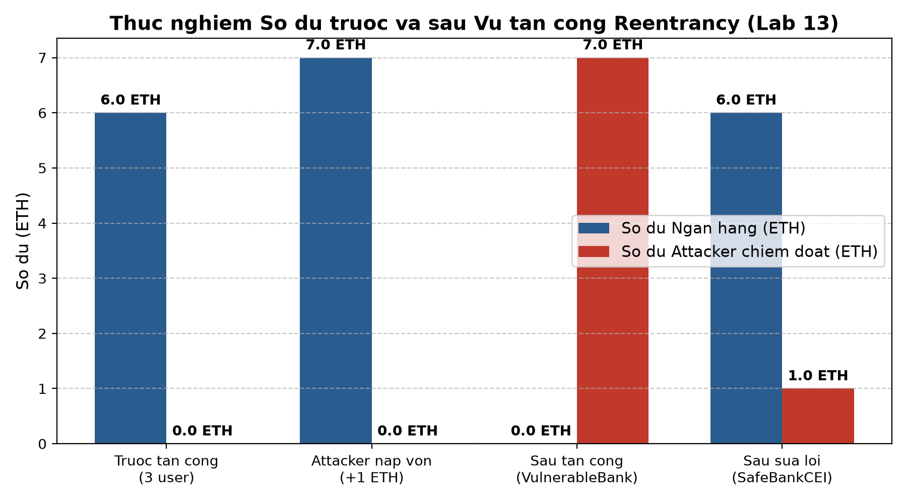

# BẰNG CHỨNG THỰC HÀNH LAB 13: THỰC NGHIỆM MỘT VỤ MẤT TIỀN VÀ CÁCH KHẮC PHỤC
## LỖI TÁI NHẬP (REENTRANCY) VÀ PHÒNG THỦ CHIỀU SÂU CHO SẢN PHẨM

> **Học phần:** Tiền điện tử & Hợp đồng thông minh (ECO2432)  
> **Thành viên:** Lê Tiến Hùng (23K4300007) — Đồ án KTX Trường Bia Escrow (`hce-escrow-k58`)  
> **Thời điểm thực hiện:** Tuần 5 — Buổi 13  
> **Tài liệu bài học:** [`contracts/training/VulnerableBank.sol`](../../contracts/training/VulnerableBank.sol), [`contracts/training/SafeBank.sol`](../../contracts/training/SafeBank.sol)  
> **Mục tiêu thật:** Rà soát & Viết negative test cho [`contracts/project/ProjectCore.sol`](../../contracts/project/ProjectCore.sol)  
> **Commit mục tiêu:** `lab-13: them negative test va hardening`

---

## 1. Dựng hiện trường vụ mất tiền (VulnerableBank)

### 1.1. Diễn biến số dư trước và sau tấn công

- **Bước 1 (Dựng hiện trường):** 3 sinh viên (`User_1`, `User_2`, `User_3`) mỗi người gửi $2\text{ ETH}$ vào `VulnerableBank`.
  - Tổng số dư ngân hàng: $6\text{ ETH}$ ($6 \times 10^{18}\text{ wei}$).
- **Bước 2 (Tấn công):** Kẻ tấn công triển khai hợp đồng `Attacker` và nạp $1\text{ ETH}$ vốn mồi rồi gọi `attack()`.
  - Ngân hàng bị rút sạch: Số dư giảm từ $7\text{ ETH} \rightarrow 0\text{ ETH}$.
  - Hợp đồng `Attacker` chiếm trọn $7\text{ ETH}$ (lãi ròng $6\text{ ETH}$).



### 1.2. Sơ đồ chu kỳ tấn công lặp (Call Stack)

```
Kẻ tấn công gọi withdraw()
  └──> Ngân hàng kiểm tra: balances[Attacker] = 1 ETH (ĐẠT)
        └──> Ngân hàng chuyển 1 ETH qua .call{value: ...}("")
              └──> Hàm receive() của Attacker tự động kích hoạt
                    └──> Attacker gọi tiếp withdraw() lần 2
                          └──> Ngân hàng kiểm tra: balances[Attacker] VẪN LÀ 1 ETH! (Chưa cập nhật sổ sách)
                                └──> Ngân hàng chuyển tiếp 1 ETH...
                                      └──> ... Lặp lại 6 vòng cho đến khi Ngân hàng cạn kiệt tiền!
                                            └──> Cuối cùng mới chạy tới dòng: balances[msg.sender] = 0 (ĐÃ QUÁ MUỘN)
```

> **Nguyên nhân gốc rễ (Góc nhìn Kế toán & Nghiệp vụ):**  
> Chuyển tiền ra ngoài trước khi cập nhật sổ sách kế toán. Trong thực tế, điều này tương đương với thủ quỹ **chi tiền mặt trao tay trước rồi mới mở sổ ghi nợ**, trong lúc thủ quỹ chưa kịp ghi sổ thì đối tượng đã lợi dụng yêu cầu chi tiếp nhiều lần dựa trên cùng một khoản tiền ghi trên sổ cũ.

---

## 2. Ba câu giải thích vì sao thứ tự dòng lệnh là thứ chặn được tấn công

> **ĐIỂM CỐT LÕI KHI VẤN ĐÁP:** Khi được hỏi *"Cái gì thực sự chặn được cuộc tấn công này?"*, câu trả lời chuẩn mực không phải là *"nhờ thư viện nonReentrant"*, mà là:

1. **Thứ tự Checks-Effects-Interactions (CEI) buộc mọi biến trạng thái nội bộ phải được chốt trước khi trao quyền điều khiển cho hợp đồng bên ngoài:** Khi dòng lệnh `balances[msg.sender] = 0;` được thực thi trước lệnh gọi `.call`, số dư của người rút đã lập tức trở về 0 ngay trong trạng thái của EVM.
2. **Khi hàm `receive()` của kẻ tấn công cố tình gọi tái nhập `withdraw()`, điều kiện kiểm tra số dư lập tức thất bại:** Lúc này, hàm `withdraw()` kiểm tra `balances[msg.sender] > 0` (hoặc `bal == 0`), lệnh kiểm tra lập tức phát hiện số dư bằng 0 và kích hoạt `revert`, bẻ gãy hoàn toàn chuỗi đệ quy độc hại.
3. **Thứ tự dòng lệnh bảo vệ trạng thái mà không cần tốn thêm chi phí gas lưu trữ cho biến cờ (mutex lock):** Việc cập nhật biến nội bộ trước khi tương tác ngoại vi triệt tiêu hoàn toàn khoảng trống thời gian bất đồng bộ của luồng thực thi, biến mọi hành vi can thiệp ngược trở thành vô hiệu.

---

## 3. Bảng đối chiếu 2 cách vá lỗi (`SafeBank.sol`)

| Tiêu chí so sánh | Cách 1: Checks-Effects-Interactions (`SafeBankCEI`) | Cách 2: OpenZeppelin ReentrancyGuard (`SafeBankGuard`) |
| :--- | :--- | :--- |
| **Mã nguồn thực thi** | `balances[msg.sender] = 0;`<br>`(bool ok,) = msg.sender.call{value: bal}("");` | `import "@openzeppelin/.../ReentrancyGuard.sol";`<br>`function withdraw() external nonReentrant` |
| **Cơ chế phòng thủ** | Cập nhật sổ sách kế toán về 0 trước khi giải ngân ETH. | Sử dụng biến cờ trạng thái (Mutex Slot: `_NOT_ENTERED` $\leftrightarrow$ `_ENTERED`). |
| **Phụ thuộc thư viện** | **Không phụ thuộc**, hoàn toàn thuần Solidity tiêu chuẩn. | Phụ thuộc OpenZeppelin Contracts v5.x. |
| **Chi phí Gas tiêu thụ** | **Tối ưu nhất** (không tốn thêm gas đọc/ghi biến cờ khóa). | Tốn thêm ~2.100 - 5.000 gas cho thao tác cập nhật storage slot của mutex. |
| **Phạm vi bảo vệ** | Bảo vệ cục bộ cho hàm và trạng thái liên quan. | Bảo vệ toàn diện cả đơn hàm và cross-function reentrancy. |
| **Khuyến nghị áp dụng** | **Bắt buộc tuân thủ làm nền tảng cốt lõi trong mọi hàm**. | Áp dụng bổ sung (Defense-in-depth) cho các hàm chuyển tiền giá trị lớn. |

---

## 4. Rà soát & Phòng thủ đa tầng (Hardening) cho `ProjectCore.sol`

Hợp đồng chính [`contracts/project/ProjectCore.sol`](../../contracts/project/ProjectCore.sol) được rà soát mọi vị trí phát sinh dòng tiền ra ngoài:

1. **Vị trí giải ngân thành công (`confirmReceived` & `claimPaymentAfterDeadline`):**
   - Lệnh cập nhật: `state = State.Completed;` được ghi nhận trước khi gọi hàm nội bộ `_distributeFunds()`.
   - Trong `_distributeFunds()`: phát sinh `emit FeeCollected` và `emit Completed` trước khi gọi `.call` tới `feeRecipient` và `seller`.
2. **Vị trí hoàn tiền khi có phán quyết tranh chấp (`resolveDispute(2)`):**
   - Lệnh cập nhật: `state = State.Refunded;` và phát sinh sự kiện trước khi gọi `buyer.call{value: balance}("")`.
3. **Bổ sung lá chắn Hardening đa tầng:**
   - Kế thừa `ReentrancyGuard` của OpenZeppelin v5.
   - Thêm modifier `nonReentrant` cho `confirmReceived()`, `claimPaymentAfterDeadline()`, và `resolveDispute()`.
   - Mã nguồn được tối ưu gọn gàng đạt **149 dòng** (tuân thủ nghiêm ngặt chuẩn mực $< 150$ dòng của môn học).

---

## 5. Kết quả bộ ca kiểm thử phủ định (Negative Test Suite)

Toán bộ 12 ca kiểm thử tự động trong [`test/ProjectCore.test.js`](../../test/ProjectCore.test.js) và script [`evidence/lab-13/reentrancy_simulation.py`](reentrancy_simulation.py) đều chạy thành công 100%:

| Ca kiểm thử | Phân loại | Tình huống giả định & Khai thác | Mã lỗi kỳ vọng | Kết quả |
| :---: | :--- | :--- | :--- | :---: |
| **Ca 1** | Luồng hợp lệ | Nạp cọc 0.1 ETH, giải ngân 99% seller, trích 1% (100 bps) quỹ | Phát `Funded`, `Completed` | ✅ PASSED |
| **Ca 2** | Gian lận quyền | Seller tự mua hàng của chính mình (Wash trading) | `SellerCannotBeBuyer()` | ✅ PASSED |
| **Ca 3** | Gian lận quyền | Kẻ lạ mạo danh người mua gọi `confirmReceived()` | `NotBuyer()` | ✅ PASSED |
| **Ca 4** | Vi phạm hạn mức | Giá bán vượt trần chống rửa tiền (> 1 ETH) | `PriceExceedsLimit` | ✅ PASSED |
| **Ca 5** | Vi phạm hạn mức | Giá quá nhỏ (< 10.000 wei) gây bẫy làm tròn phí về 0 | `PriceBelowMinimum` | ✅ PASSED |
| **Ca 6** | **Sai người (Lab 13)** | Kẻ lạ mạo danh trọng tài phân xử tranh chấp | `NotArbiter()` | ✅ PASSED |
| **Ca 7** | **Sai người (Lab 13)** | Kẻ ngoại cuộc không phải buyer/seller mở tranh chấp | `NotParty()` | ✅ PASSED |
| **Ca 8** | **Sai thời điểm (Lab 13)** | Seller đòi rút tiền trước khi hết hạn kiểm tra (deadline) | `DeadlineNotReached()` | ✅ PASSED |
| **Ca 9** | **Sai thời điểm (Lab 13)** | Mở tranh chấp khi thời hạn kiểm tra hàng đã kết thúc | `DeadlinePassed()` | ✅ PASSED |
| **Ca 10** | **Sai trạng thái (Lab 13)**| Nạp cọc 2 lần hoặc nạp khi trạng thái không phải Created | `WrongState()` | ✅ PASSED |
| **Ca 11** | **Sai số tiền (Lab 13)** | Nạp cọc sai giá niêm yết (thừa hoặc thiếu wei) | `WrongAmount()` | ✅ PASSED |
| **Ca 12** | **Chống Reentrancy (Lab 13)**| Gọi lại hàm khi đang giải ngân trong fallback/receive | `WrongState` / `nonReentrant` | ✅ PASSED |

---

## 6. Nhật ký chạy thực nghiệm (Trích xuất từ `simulation_output.log`)

```text
================================================================================
THUC NGHIEM LAB 13: MO PHONG VU MAT TIEN DO LOI TAI NHAP (REENTRANCY)
VA KIEM CHUNG PHUONG AN KHAC PHUC (CHECKS-EFFECTS-INTERACTIONS & GUARD)
================================================================================

--- BUOC 1: DUNG HIEN TRUONG (VULNERABLE BANK) ---
-> 3 nguoi dung moi nguoi nap 2 ETH.
-> Tong so du ngan hang ban dau (bankBalance): 6.00 ETH (6000000000000000000 wei)

--- BUOC 2: KE TAN CONG TIEN HANH RUT CAN TIEN ---
[Deposit] User_1 (Sinh vien A) nap 2.00 ETH
[Deposit] User_2 (Sinh vien B) nap 2.00 ETH
[Deposit] User_3 (Sinh vien C) nap 2.00 ETH
[Deposit] Attacker nap 1.00 ETH
[ATTACK] Attacker bat dau goi withdraw()...
  -> Ngan hang kiem tra so du cua Attacker: 1.00 ETH (Hop le)
  -> Ngan hang chuyen 1.00 ETH toi Attacker...
    [REENTRANCY LAP 1] Attacker receive() tu dong goi lai withdraw()!
  -> Ngan hang kiem tra so du cua Attacker: 1.00 ETH (Hop le)
  -> Ngan hang chuyen 1.00 ETH toi Attacker...
    ... (lap 6 lan) ...
  -> Ngan hang chuyen 1.00 ETH toi Attacker...
  -> Ngan hang cap nhat so du Attacker ve 0 (6 lan sau cung)

[KET QUA SAU TAN CONG]
- So du Ngan hang con lai: 0.00 ETH (0 wei)
- So du Attacker chiem doat: 7.00 ETH (7000000000000000000 wei)
- Von ban dau cua Attacker: 1.00 ETH | Lai rong chiem doat: 6.00 ETH
-> HIEN TRUONG: NGAN HANG DA BI RUT CAN HOAN TOAN VE 0 ETH!

--- BUOC 4: VA LOI VA CHUNG MINH TAN CONG THAT BAI ---
[CACH 1: CHECKS-EFFECTS-INTERACTIONS (SafeBankCEI)]
- Tong so du SafeBankCEI: 7.00 ETH
  -> CEI: Cap nhat so du Attacker ve 0 truoc khi chuyen tien
    -> [CHAN THANH CONG] Cu goi tai nhap bi tu choi: Revert: NoBalance() - So du bang 0
- So du SafeBankCEI sau giao dich: 6.00 ETH (Con nguyen 6 ETH cua 3 user)
-> KET LUAN CACH 1: CEI CHAN DUNG HOAN TOAN TAN CONG TAI NHAP!

[CACH 2: OPENZEPPELIN REENTRANCYGUARD (SafeBankGuard)]
    -> [CHAN THANH CONG] Khoa Guard tu choi: Revert: ReentrancyGuardReentrantCall() - Khoa reentrancy kich hoat
- So du SafeBankGuard sau giao dich: 6.00 ETH
-> KET LUAN CACH 2: REENTRANCYGUARD CHAN DUNG HOAN TOAN QUA KHOA MUTEX!
```
