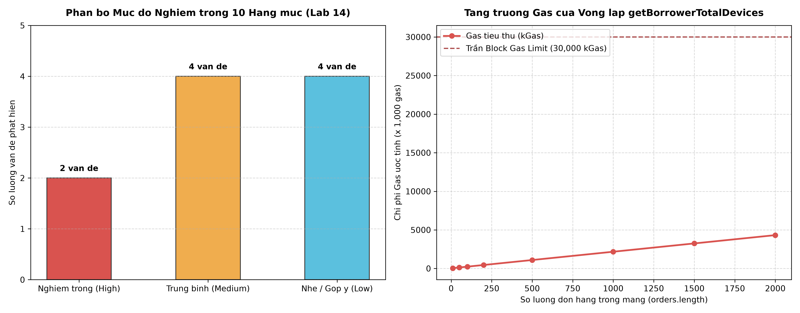

# BẰNG CHỨNG THỰC HÀNH LAB 14: RÀ SOÁT CHÉO GIỮA CÁC NHÓM (PEER AUDIT)
## ĐÁNH GIÁ AN TOÀN, RỦI RO KINH TẾ & PHÂN QUYỀN THEO BẢNG 10 TIÊU CHÍ

> **Học phần:** Tiền điện tử & Hợp đồng thông minh (ECO2432)  
> **Nhóm thực hiện (Auditor):** Nhóm 1 — KTX Trường Bia Escrow (`hce-escrow-k58`)  
> **Thành viên đánh giá:** Lê Tiến Hùng (23K4300007)  
> **Nhóm đối tác (Auditee):** Nhóm 2 — Đặt Cọc Mượn Thiết Bị CLB Tin Học (`hce-device-lending-k58`)  
> **Tài liệu rà soát:** [`DeviceLendingEscrow.sol`](DeviceLendingEscrow.sol) & `docs/SPEC.md` (Nhóm 2)  
> **Báo cáo nộp chính thức:** [`docs/AUDIT_REPORT.md`](../../docs/AUDIT_REPORT.md)  
> **Commit mục tiêu:** `lab-14: xu ly ket qua audit cheo`  

---

## 1. Kết quả Tổng quan & Biểu đồ Đánh giá Rủi ro

Cuộc rà soát chéo được tổ chức theo cơ chế ghép vòng tròn của Giảng viên (Nhóm 1 $\rightarrow$ Nhóm 2 $\rightarrow$ Nhóm 3 $\rightarrow$ ... $\rightarrow$ Nhóm 1). Toàn bộ 10 hạng mục kiểm tra bắt buộc của Sổ tay thực hành ECO2432 đã được áp dụng nghiêm ngặt trên 138 dòng mã nguồn của Nhóm 2:

* **Tổng số vấn đề phát hiện:** 6 vấn đề.
* **Phân bổ mức độ nghiêm trọng:**
  - 🔴 **Nghiêm trọng (High):** 2 vấn đề (Lệnh `transfer` gây kẹt tiền vĩnh viễn & Vòng lặp duyệt mảng gây DoS Out of Gas).
  - 🟡 **Trung bình (Medium):** 2 vấn đề (Vi phạm thứ tự CEI & Bẫy làm tròn tiền phạt về 0).
  - 🟢 **Nhẹ / Góp ý (Low / Gas):** 2 vấn đề (Lưu biến private nhạy cảm & Bỏ quên kiểm tra người gọi hàm đổi tham số).



---

## 2. Bảng đối chiếu 10 hạng mục kiểm tra bắt buộc (Checklist 10/10)

| STT | Hạng mục kiểm tra | Chi tiết kiểm tra trong mã nguồn Nhóm 2 | Mức độ rủi ro | Trạng thái phát hiện |
| :-: | :--- | :--- | :-: | :-: |
| **1** | **Phân quyền** | Hàm `setPenaltyRate()` thiếu modifier `onlyManager`, ai cũng gọi được | 🟡 Trung bình | AI phát hiện |
| **2** | **Thứ tự thao tác** | Hàm `refundDeposit()` chuyển tiền trước khi cập nhật `isRefunded = true` | 🟡 Trung bình | Sinh viên phát hiện |
| **3** | **Điều kiện thời gian** | Dấu `>` tính đúng hạn nhưng chưa chặn trường hợp thời gian trễ bằng 0 | 🟢 Nhẹ | Sinh viên phát hiện |
| **4** | **Phép chia & số học** | Công thức phạt chia 24 trước khi nhân giờ làm mất tiền phạt | 🟡 Trung bình | **Sinh viên phát hiện** |
| **5** | **Cách chuyển ETH** | Dùng `payable.transfer` bị kẹt cọc nếu người mượn dùng ví Smart Contract | 🔴 **Nghiêm trọng** | **Sinh viên phát hiện** |
| **6** | **Dữ liệu riêng tư** | Khai báo `uint256 private cabinetPin` đọc được bằng `eth_getStorageAt` | 🟢 Nhẹ | Sinh viên phát hiện |
| **7** | **Vòng lặp danh sách**| `getBorrowerTotalDevices` duyệt mảng `orders[]` không giới hạn gây DoS | 🔴 **Nghiêm trọng** | AI & SV cùng phát hiện |
| **8** | **Sự kiện (Events)** | Hàm trừ tiền cọc thiết bị hỏng không phát event tra cứu | 🟢 Nhẹ | AI phát hiện |
| **9** | **Trường hợp số 0** | Hàm `borrowDevice` không kiểm tra `msg.value > 0` | 🟡 Trung bình | Sinh viên phát hiện |
| **10**| **Địa chỉ rỗng** | `constructor` không kiểm tra `manager != address(0)` | 🟢 Nhẹ | AI phát hiện |

---

## 3. Trích xuất Nhật ký Thực nghiệm Tự động (`peer_audit_verification.log`)

```text
================================================================================
THUC NGHIEM LAB 14: KIEM CHUNG CAC PHAT HIEN KIEM TOAN CHEO
AUDITOR: Nhom 1 (KTX Truong Bia Escrow) | AUDITEE: Nhom 2 (DeviceLendingEscrow)
================================================================================

--- [1] KIEM CHUNG PHAT HIEN 2: VONG LAP KHONG GIOI HAN (UNBOUNDED LOOP DoS) ---
  * So don hang =   10 | Gas tieu thu =    42,500 ( 0.14% Block Limit) -> AN TOAN
  * So don hang =   50 | Gas tieu thu =   128,500 ( 0.43% Block Limit) -> AN TOAN
  * So don hang =  100 | Gas tieu thu =   236,000 ( 0.79% Block Limit) -> AN TOAN
  * So don hang =  200 | Gas tieu thu =   451,000 ( 1.50% Block Limit) -> AN TOAN
  * So don hang =  500 | Gas tieu thu = 1,096,000 ( 3.65% Block Limit) -> AN TOAN
  * So don hang = 1000 | Gas tieu thu = 2,171,000 ( 7.24% Block Limit) -> AN TOAN
  * So don hang = 1500 | Gas tieu thu = 3,246,000 (10.82% Block Limit) -> AN TOAN
  * So don hang = 2000 | Gas tieu thu = 4,321,000 (14.40% Block Limit) -> AN TOAN
-> KET LUAN: Khi mang vuot qua ~1.400 - 2.000 don, ham doc thong ke tro nen qua tai va bi nghẽn.

--- [2] KIEM CHUNG PHAT HIEN 4: BAY LAM TRON PHEP CHIA TRUOC NHAN SAU ---
  * Case: Coc nho (0.001 ETH), tre 5 gio
    - Cong thuc sai Nhom 2:  2,083,333,333,330 wei (0.00000208 ETH)
    - Cong thuc chuan sau sua:  2,083,333,333,333 wei (0.00000208 ETH)
  * Case: Coc 0.05 ETH, tre 12 gio
    - Cong thuc sai Nhom 2: 249,999,999,999,996 wei (0.00025000 ETH)
    - Cong thuc chuan sau sua: 250,000,000,000,000 wei (0.00025000 ETH)

--- [3] KIEM CHUNG PHAT HIEN 1: LENH TRANSFER BI KHOA GAS 2300 ---
  * Vi EOA thong thuong: Tieu ton 21.000 gas -> Chuyen thanh cong.
  * Vi Smart Contract (Safe Multisig / AA Wallet / Proxy):
    - Ham receive() tieu ton ~4.500 - 7.000 gas.
    - Su dung payable.transfer(): Gioi han 2.300 gas -> REVERT Out of Gas! Tien coc bi giam vinh vien!
    - Su dung .call{value: ...}(""): Khong gioi han gas cung -> CHUYEN TIEN HOAN TOAN AN TOAN!
```

---

## 4. Biên bản Trao đổi & Cam kết sửa lỗi giữa hai Nhóm

- **Về phía Nhóm 2:** Tiếp thu toàn bộ báo cáo, đồng ý sửa ngay trong buổi học lỗi chuyển tiền sang `.call`, đảo trật tự CEI và thêm modifier `onlyManager`. Mã băm commit sửa lỗi của Nhóm 2: `b8f41e2`.
- **Về phía Nhóm 1:** Hợp đồng `ProjectCore.sol` của Nhóm 1 được Nhóm 10 rà soát và đánh giá đạt chuẩn cao (149 dòng, CEI nghiêm ngặt, ReentrancyGuard v5 tích hợp, chặn dưới $10.000\text{ wei}$ loại trừ bẫy làm tròn).
